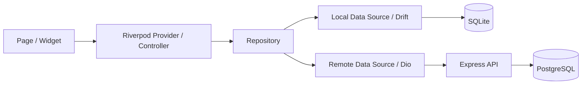
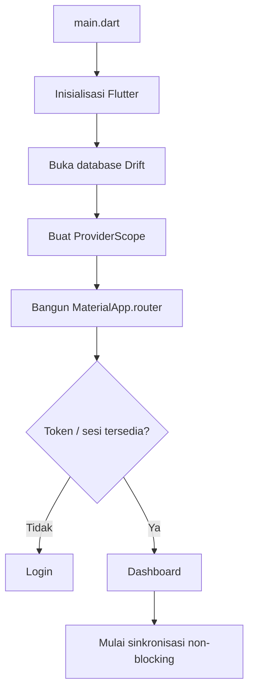
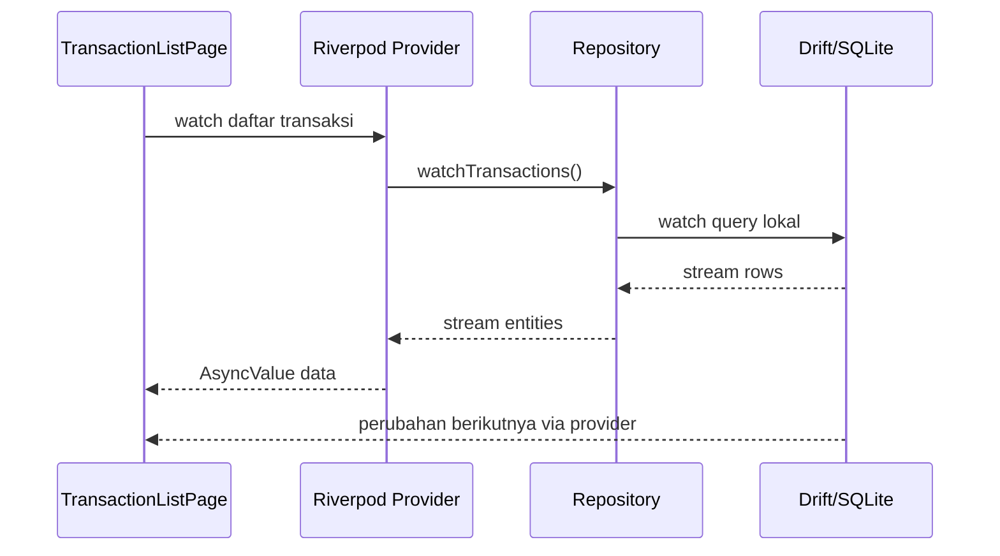
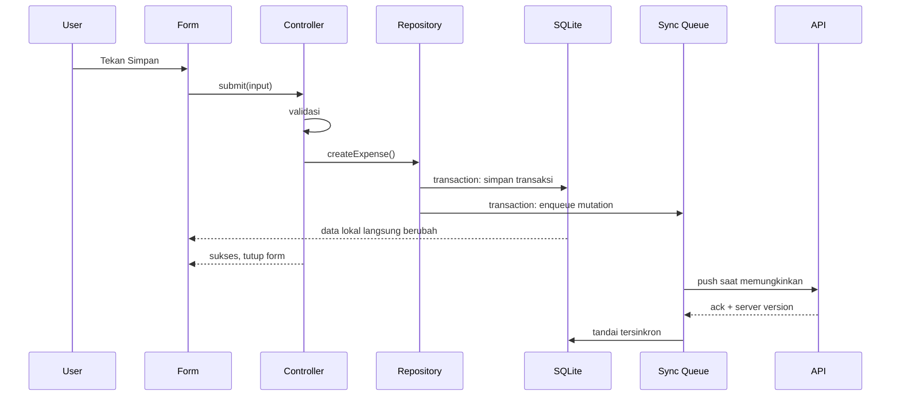

# Panduan Development Vesper Mobile

Panduan ini ditujukan untuk developer yang masih baru dengan Flutter. Dokumen ini menjelaskan cara berpikir, alur data, struktur file, dan langkah aman ketika mengembangkan aplikasi pencatatan keuangan keluarga dan manajemen aset ini.

> **Status proyek saat dokumen ini dibuat:** kode aplikasi masih berupa starter/counter bawaan Flutter. Struktur dan teknologi di bawah adalah target arsitektur yang ditetapkan di [`AGENTS.md`](../AGENTS.md), bukan berarti semuanya sudah tersedia. Periksa [`pubspec.yaml`](../pubspec.yaml) sebelum memakai package karena Riverpod, Drift, Dio, dan package target lainnya mungkin belum dipasang.

---

## 1. Gambaran Besar Produk

Vesper adalah aplikasi mobile untuk:

- mencatat pemasukan dan pengeluaran pribadi;
- mengelola keuangan bersama dalam sebuah household/keluarga;
- melihat saldo beberapa akun seperti kas, bank, dan dompet digital;
- memindahkan uang antar-akun;
- mencatat pembelian dan penjualan investasi;
- melihat posisi aset dan untung/rugi yang belum direalisasikan;
- tetap dapat digunakan ketika offline;
- menyinkronkan perubahan ke server ketika koneksi tersedia.

Prioritas pengembangan:

1. angka dan aturan finansial harus benar;
2. data tetap dapat disimpan saat offline;
3. antarmuka mudah dipahami;
4. sinkronisasi dapat diprediksi dan aman diulang;
5. kode mudah dirawat dan diuji.

## 2. Referensi Desain

Referensi visual berada di:

- [`assets/images/contoh-1.png`](../assets/images/contoh-1.png)
- [`assets/images/contoh-2.png`](../assets/images/contoh-2.png)
- logo di [`assets/images/`](../assets/images/)

Gunakan gambar tersebut sebagai **arah visual**, bukan sebagai alasan untuk menaruh seluruh halaman dalam satu file. Pecah tampilan menjadi widget kecil yang dapat digunakan ulang, misalnya kartu saldo, item transaksi, pemilih akun, dan navigasi bawah.

Sebelum aset dapat digunakan oleh Flutter, daftarkan path-nya di bagian `flutter:` dalam [`pubspec.yaml`](../pubspec.yaml):

```yaml
flutter:
  uses-material-design: true
  assets:
    - assets/images/
```

Setelah mengubah `pubspec.yaml`, jalankan `flutter pub get`.

---

## 3. Mental Model Flutter untuk Pemula

### 3.1 Widget

Hampir semua elemen layar Flutter adalah **widget**: teks, tombol, padding, layout, dan halaman. Widget sebaiknya hanya bertanggung jawab menampilkan state dan meneruskan aksi pengguna.

- `StatelessWidget`: tampilannya hanya bergantung pada input.
- `ConsumerWidget`: seperti stateless widget, tetapi dapat membaca provider Riverpod.
- `ConsumerStatefulWidget`: dipakai jika ada state UI lokal dan perlu Riverpod.
- Hindari `StatefulWidget` hanya untuk menyimpan data bisnis yang seharusnya berada di provider/repository.

### 3.2 State

State adalah data yang dapat mengubah tampilan. Bedakan:

- **State UI lokal:** tab aktif, input sedang disembunyikan, animasi, fokus field.
- **State aplikasi:** transaksi, akun, household, status login, status sinkronisasi.

State UI lokal boleh berada di widget. State aplikasi harus dikelola Riverpod dan sumber datanya melalui repository.

### 3.3 Build ulang

Method `build()` dapat dipanggil berkali-kali. Karena itu, jangan melakukan query database, request API, menulis data, atau operasi berat langsung di `build()`.

---

## 4. Arsitektur Utama

Gunakan alur berikut untuk setiap fitur:



Tanggung jawab tiap lapisan:

| Lapisan | Tanggung jawab | Tidak boleh |
|---|---|---|
| UI | Menampilkan data, input, loading/error, memanggil aksi | Query SQL, request HTTP, hitung aturan finansial |
| Provider/controller | Mengelola state halaman dan mengorkestrasi use case | Menulis SQL atau detail endpoint |
| Repository | Menentukan sumber data dan alur offline-first | Mengatur layout/widget |
| Local data source | Query Drift/SQLite | Mengetahui tampilan |
| Remote data source | Memanggil REST API dan mengubah JSON | Menjadi sumber utama tampilan |

Aturan praktis: jika widget mengetahui nama tabel SQLite atau URL endpoint, berarti batas arsitekturnya salah.

---

## 5. Struktur Folder Target

Struktur awal yang disarankan:

```text
lib/
├── main.dart
├── app/
│   ├── app.dart
│   ├── router.dart
│   └── theme/
│       ├── app_colors.dart
│       └── app_theme.dart
├── core/
│   ├── constants/
│   ├── errors/
│   ├── network/
│   │   └── dio_provider.dart
│   ├── utils/
│   │   ├── money.dart
│   │   └── date_time.dart
│   └── widgets/
├── database/
│   ├── app_database.dart
│   ├── tables/
│   ├── daos/
│   └── migrations/
└── features/
    ├── auth/
    ├── household/
    ├── accounts/
    ├── categories/
    ├── transactions/
    ├── investments/
    ├── reports/
    └── sync/
```

Jangan membuat semua folder sekaligus jika belum dipakai. Tambahkan ketika fitur pertama membutuhkannya.

### 5.1 Struktur dalam satu fitur

Contoh fitur transaksi:

```text
features/transactions/
├── data/
│   ├── local/
│   │   └── transaction_local_data_source.dart
│   ├── remote/
│   │   └── transaction_remote_data_source.dart
│   ├── models/
│   │   └── transaction_model.dart
│   └── transaction_repository.dart
├── domain/
│   └── transaction.dart
└── presentation/
    ├── controllers/
    │   └── transaction_form_controller.dart
    ├── providers/
    │   └── transaction_providers.dart
    ├── pages/
    │   ├── transaction_list_page.dart
    │   └── transaction_form_page.dart
    └── widgets/
        └── transaction_list_tile.dart
```

Struktur dapat disederhanakan untuk fitur kecil. Yang penting adalah UI, pengelolaan state, dan akses data tidak dicampur dalam satu file.

### 5.2 Kapan file diletakkan di `core/`?

Taruh kode di `core/` hanya jika benar-benar digunakan oleh beberapa fitur, contohnya formatter uang, konfigurasi Dio, error umum, atau widget loading generik. Kode khusus transaksi tetap berada di fitur transaksi.

---

## 6. Alur Startup Aplikasi

Target alur saat aplikasi dibuka:



Pembagian file:

- `lib/main.dart`: bootstrap sesingkat mungkin.
- `lib/app/app.dart`: `MaterialApp.router`, theme, dan konfigurasi aplikasi.
- `lib/app/router.dart`: route, redirect autentikasi, dan shell navigasi.
- `lib/database/app_database.dart`: koneksi dan definisi database.
- `lib/features/auth/`: login, token, dan state sesi.
- `lib/features/sync/`: koordinasi push/pull di background.

Jangan menunggu sinkronisasi selesai untuk membuka dashboard. UI membaca data lokal terlebih dahulu.

---

## 7. Alur Membaca Data

Contoh menampilkan daftar transaksi:



Prinsip penting:

- UI selalu membaca data utama dari SQLite.
- Drift stream memberi pembaruan otomatis ketika tabel berubah.
- Hasil API disimpan ke SQLite; UI akan ikut berubah dari stream database.
- Provider menangani tiga kondisi: loading, data, dan error.

---

## 8. Alur Menulis Data: Local First

Contoh pengguna menambahkan pengeluaran:



Penyimpanan entitas dan penambahan sync queue harus berada dalam satu transaksi database agar tidak ada perubahan lokal yang lupa disinkronkan.

UI tidak boleh gagal menyimpan hanya karena internet mati. Error sinkronisasi ditampilkan sebagai status yang dapat dicoba ulang, bukan menghapus perubahan lokal pengguna.

---

## 9. Aturan Finansial yang Wajib Dijaga

### 9.1 Uang tidak boleh memakai floating point

Jangan menyimpan uang sebagai `double`, karena representasi biner dapat menimbulkan selisih pembulatan. Gunakan integer dalam unit terkecil.

Untuk Rupiah tanpa pecahan:

- Rp10.000 disimpan sebagai integer `10000`.

Jika kelak mendukung mata uang dengan sen:

- $10.25 disimpan sebagai integer `1025` cent.

Sertakan kode mata uang seperti `IDR` jika sistem mendukung lebih dari satu mata uang. Formatting hanya dilakukan untuk tampilan.

### 9.2 Jenis transaksi

- `INCOME`: menambah saldo akun.
- `EXPENSE`: mengurangi saldo akun.
- `TRANSFER`: mengurangi akun asal dan menambah akun tujuan; **bukan** income atau expense.
- `INVESTMENT_BUY`: mengurangi kas dan menambah posisi investasi.
- `INVESTMENT_SELL`: mengurangi posisi investasi dan menambah kas.

Transfer dan investasi idealnya disimpan sebagai operasi yang saling terkait agar kedua sisi konsisten. Jangan mengubah aturan ini diam-diam ketika membuat UI.

### 9.3 Saldo

Tentukan satu strategi dan gunakan konsisten:

- saldo dihitung dari seluruh transaksi; atau
- saldo tersimpan diperbarui secara atomik bersama transaksi.

Jika menggunakan saldo tersimpan untuk performa, repository/database transaction wajib memastikan transaksi dan saldo tidak pernah berbeda.

### 9.4 Validasi minimum

Sebelum menyimpan transaksi, validasi:

- nominal lebih besar dari nol;
- akun dipilih;
- kategori sesuai tipe transaksi;
- akun asal dan tujuan transfer berbeda;
- tanggal valid;
- investment buy/sell memiliki aset dan kuantitas valid;
- sell tidak melanggar aturan kepemilikan yang disepakati.

---

## 10. Entity, Model, dan Tabel

Istilah yang sering membingungkan:

- **Entity/domain object:** bentuk data yang digunakan oleh aturan bisnis.
- **Model/DTO:** bentuk data untuk request/response API dan serialisasi JSON.
- **Table row/data class:** bentuk data yang dihasilkan Drift.
- **Form state:** data sementara yang sedang diisi pengguna.

Pada fitur sederhana bentuknya boleh mirip, tetapi jangan memaksa satu class mengetahui UI, JSON, dan database sekaligus bila mulai sulit dirawat.

Entitas sinkronisasi minimal biasanya mempunyai:

- `id`: UUID yang dibuat client;
- `householdId`;
- `createdAt` dan `updatedAt`;
- `deletedAt` atau flag tombstone;
- `serverVersion`;
- status sinkronisasi bila diperlukan.

Gunakan waktu UTC untuk penyimpanan dan sinkronisasi. Konversi ke waktu lokal hanya saat ditampilkan.

---

## 11. Offline-First dan Sinkronisasi

### 11.1 Mengapa UUID dibuat di client?

Aplikasi harus dapat membuat data tanpa server. UUID memungkinkan record memiliki ID final sejak dibuat offline dan membantu request menjadi idempotent.

### 11.2 Soft delete

Jangan langsung menghapus record sinkron dari database. Tandai sebagai dihapus (`deletedAt`) lalu kirim tombstone ke server. Hard delete lokal baru dapat dilakukan setelah kebijakan retensi/ack sinkronisasi jelas.

### 11.3 Push dan pull

Siklus sinkronisasi yang disarankan:

1. Cegah dua proses sync berjalan bersamaan.
2. Push item queue yang pending berdasarkan urutan yang aman.
3. Gunakan mutation/request ID agar retry tidak membuat data duplikat.
4. Tandai berhasil atau simpan error/retry count.
5. Pull perubahan server sejak cursor terakhir.
6. Terapkan perubahan server dalam transaksi SQLite.
7. Simpan cursor baru hanya setelah seluruh batch berhasil.
8. Beri tahu state sync tanpa memblokir penggunaan aplikasi.

### 11.4 Trigger bukan jaminan

`connectivity_plus` hanya memberi tahu bahwa perangkat terhubung ke suatu jaringan. Itu bukan bukti API dapat dijangkau. Semua request tetap harus memiliki timeout, error handling, dan retry dengan jeda yang masuk akal.

### 11.5 Konflik

Mulai dengan aturan sederhana dan terdokumentasi, misalnya server version + last-write-wins untuk field biasa. Data finansial sensitif sebaiknya tidak digabung sembarangan. Jika konflik berisiko mengubah nominal, pertahankan data, catat konflik, dan minta penyelesaian yang jelas daripada menghapus perubahan diam-diam.

---

## 12. Riverpod: Pola Pengelolaan State

Jenis provider yang umum:

- provider dependency: database, Dio, secure storage, repository;
- stream provider: daftar akun/transaksi yang berasal dari Drift;
- future provider: operasi baca satu kali;
- notifier/controller: form, aksi simpan, login, dan sinkronisasi.

Pola UI yang diharapkan:

1. widget `watch` state untuk render;
2. widget `read` controller hanya saat event seperti tombol ditekan;
3. controller memvalidasi dan memanggil repository;
4. repository mengubah database;
5. stream database membuat UI ter-update.

Hindari provider global untuk state yang hanya relevan pada satu widget kecil. Hindari pula memanggil `ref.read(...).save()` dari dalam `build()`.

---

## 13. Routing dengan `go_router`

Rute awal yang masuk akal:

```text
/splash
/login
/home
/accounts
/accounts/:accountId
/transactions
/transactions/new
/transactions/:transactionId
/investments
/reports
/settings
```

Gunakan satu konfigurasi router pusat di `lib/app/router.dart`. Redirect login membaca state autentikasi. Parameter route berisi identifier seperti ID; halaman mengambil detail melalui provider/repository, bukan menerima object besar yang mudah stale.

Jika menggunakan bottom navigation, pertahankan state tiap tab dengan shell route yang sesuai, bukan membuat router terpisah per widget.

---

## 14. API, Token, dan Error

### 14.1 Dio

Buat satu konfigurasi Dio bersama yang menangani:

- base URL dari konfigurasi environment;
- timeout;
- header JSON;
- penyisipan access token;
- pemetaan error;
- refresh token jika backend mendukungnya.

Jangan membuat instance Dio baru di setiap halaman.

### 14.2 Token

Simpan token autentikasi di `flutter_secure_storage`, bukan `SharedPreferences`, source code, atau log. Jangan pernah mencetak token dan data finansial sensitif ke console.

### 14.3 Error untuk pengguna

Pisahkan error teknis dengan pesan UI:

- validasi input: tunjukkan dekat field;
- database lokal gagal: beri pesan bahwa penyimpanan gagal;
- sync gagal: data lokal tetap ada, tunjukkan status retry;
- sesi habis: coba refresh atau arahkan login;
- server error: jangan tampilkan stack trace kepada pengguna.

---

## 15. Database Drift

### 15.1 Lokasi tanggung jawab

- `database/tables/`: definisi tabel.
- `database/daos/`: query yang terkait tabel/use case.
- `database/app_database.dart`: registrasi tabel/DAO, versi schema, migration.
- repository: menggabungkan DAO dan remote data source menjadi alur bisnis.

### 15.2 Migration

Setiap perubahan schema harus:

1. menaikkan schema version;
2. menambahkan migration yang menjaga data lama;
3. diuji dari versi sebelumnya ke versi baru;
4. tidak hanya menghapus database agar aplikasi “berhasil jalan”.

Backup data pengguna lebih penting daripada kenyamanan development.

### 15.3 Generated files

Drift, Freezed, dan JSON serialization dapat menghasilkan file seperti `.g.dart` dan `.freezed.dart`. Jangan edit manual. Ubah source lalu jalankan:

```text
dart run build_runner build --delete-conflicting-outputs
```

---

## 16. Pola UI yang Disarankan

### 16.1 Page vs widget

- `Page`: menyusun satu layar, membaca provider, menangani navigasi.
- feature widget: komponen spesifik seperti kartu ringkasan akun.
- core widget: komponen benar-benar generik seperti empty state atau loading indicator.

Jika method `build()` terlalu panjang, ekstrak bagian yang memiliki nama/tujuan jelas. Jangan mengekstrak setiap `Padding` menjadi class tanpa manfaat.

### 16.2 Form

Pola form transaksi:

1. input disimpan dalam form/controller state;
2. validasi lokal berjalan sebelum submit;
3. tombol dinonaktifkan saat submit berlangsung;
4. repository menulis lokal dan queue secara atomik;
5. setelah berhasil lokal, kembali ke halaman sebelumnya;
6. halaman daftar berubah melalui stream database.

Cegah double submit. Tampilkan nominal dengan formatter, tetapi simpan nilai integer yang sudah dinormalisasi.

### 16.3 Loading, empty, error, dan offline

Setiap layar data harus memikirkan empat keadaan:

- loading pertama kali;
- data tersedia;
- belum ada data (empty state dengan ajakan tindakan);
- error.

Status offline/sync sebaiknya informatif dan tidak menghalangi pencatatan lokal.

### 16.4 Theme

Simpan warna, typography, radius, dan spacing utama di `lib/app/theme/`. Jangan menyalin literal warna di puluhan widget. Pastikan kontras, ukuran sentuh, dan teks tetap mudah dibaca.

---

## 17. Testing

Gunakan piramida sederhana:

### 17.1 Unit test

Untuk aturan finansial dan fungsi murni:

- perhitungan saldo;
- transfer tidak masuk laporan income/expense;
- posisi investasi dan gain/loss;
- konversi nominal input ke integer;
- conflict/retry policy.

Ini adalah test paling penting karena kesalahan angka merusak kepercayaan pengguna.

### 17.2 Repository/database test

Uji dengan database sementara/in-memory:

- transaksi dan sync queue tersimpan atomik;
- stream berubah setelah insert/update/delete;
- soft delete menghasilkan tombstone;
- migration mempertahankan data;
- retry tidak membuat duplikasi.

### 17.3 Widget test

Uji perilaku yang terlihat:

- state loading/data/empty/error;
- input dan validasi form;
- tap tombol memanggil controller;
- navigasi setelah simpan lokal berhasil.

### 17.4 Integration test

Gunakan untuk flow kritis lintas halaman, misalnya login → buat akun → tambah expense → lihat laporan. Jumlahnya tidak perlu sebanyak unit test.

Struktur test mencerminkan struktur source:

```text
test/
├── core/
├── database/
└── features/
    ├── transactions/
    └── investments/
```

---

## 18. Flow Mengembangkan Satu Fitur

Contoh saat ingin membuat fitur “Tambah Pengeluaran”:

### Langkah 1 — Tulis aturan

Sebelum coding, jawab:

- field apa yang wajib?
- data masuk ke entitas/tabel mana?
- bagaimana saldo berubah?
- apa yang terjadi ketika offline?
- bagaimana data disinkronkan?
- kondisi error apa yang terlihat pengguna?

### Langkah 2 — Periksa pola yang ada

Cari fitur paling mirip dan ikuti penamaan, provider, repository, form, dan test-nya. Jangan membuat pola arsitektur kedua tanpa alasan.

### Langkah 3 — Kerjakan dari lapisan data

Urutan yang mudah diuji:

1. entity/model dan enum;
2. table serta migration;
3. DAO/local data source;
4. remote data source bila contract API tersedia;
5. repository dan sync queue;
6. provider/controller;
7. page/widget;
8. route;
9. test.

Untuk prototipe UI, urutan dapat dibalik, tetapi jangan membiarkan mock logic tinggal permanen di widget.

### Langkah 4 — Validasi

Sebelum selesai:

1. format seluruh file Dart yang diubah;
2. jalankan code generation jika source generator berubah;
3. jalankan `flutter analyze`;
4. jalankan `flutter test`;
5. coba flow normal, offline, input salah, dan double tap;
6. periksa bahwa angka saldo/laporan tetap benar.

---

## 19. Checklist Review Berdasarkan Jenis Perubahan

### UI

- [ ] Mengikuti referensi desain dan theme proyek.
- [ ] Tidak ada business logic/query/API di widget.
- [ ] Loading, empty, error, dan offline dipikirkan.
- [ ] Layout aman pada layar kecil dan keyboard terbuka.
- [ ] Komponen interaktif memiliki label dan area sentuh yang layak.

### Transaksi finansial

- [ ] Uang disimpan sebagai integer, bukan `double`.
- [ ] Transfer tidak dihitung sebagai pemasukan/pengeluaran.
- [ ] Buy/sell mengubah kas dan posisi aset dengan benar.
- [ ] Perubahan terkait berlangsung atomik.
- [ ] Unit test mencakup aturan utama dan edge case.

### Offline/sync

- [ ] Local database diperbarui sebelum request API.
- [ ] Mutation masuk queue dalam transaksi yang sama.
- [ ] Request idempotent dan aman di-retry.
- [ ] Delete menggunakan tombstone.
- [ ] Cursor hanya maju setelah batch berhasil.
- [ ] Kegagalan server tidak menghilangkan data lokal.

### Database

- [ ] Schema version dinaikkan bila diperlukan.
- [ ] Migration menjaga data lama.
- [ ] Generated file tidak diedit manual.
- [ ] Query berada di DAO/data source, bukan widget.

### Dependency baru

- [ ] Masalah tidak dapat diselesaikan dengan dependency yang sudah ada.
- [ ] Package aktif dirawat dan kompatibel dengan versi SDK.
- [ ] Dampak ukuran, native config, lisensi, dan keamanan dipahami.
- [ ] `pubspec.yaml` dan konfigurasi platform diperbarui.

---

## 20. Perintah Harian

Jalankan dari root project:

| Tujuan | Perintah |
|---|---|
| Mengambil dependency | `flutter pub get` |
| Menjalankan aplikasi | `flutter run` |
| Melihat device | `flutter devices` |
| Analisis statis | `flutter analyze` |
| Menjalankan seluruh test | `flutter test` |
| Code generation | `dart run build_runner build --delete-conflicting-outputs` |
| Mengamati code generation | `dart run build_runner watch --delete-conflicting-outputs` |
| Membersihkan build | `flutter clean` lalu `flutter pub get` |

Untuk format, gunakan formatter Dart dari VS Code atau format file Dart yang diubah. Jangan memakai `flutter clean` sebagai solusi pertama untuk setiap error; baca pesan error terlebih dahulu.

---

## 21. File yang Perlu Diperhatikan

| File/folder | Kapan diperiksa |
|---|---|
| [`AGENTS.md`](../AGENTS.md) | Sebelum mengubah arsitektur atau business rule |
| [`pubspec.yaml`](../pubspec.yaml) | Dependency, SDK, assets, fonts |
| [`analysis_options.yaml`](../analysis_options.yaml) | Aturan analyzer/lint |
| `lib/main.dart` | Bootstrap aplikasi |
| `lib/app/` | Router, theme, app shell |
| `lib/database/` | Schema, DAO, migration |
| `lib/features/<fitur>/` | Semua kode milik satu fitur |
| `test/` | Test yang harus ikut berubah |
| `android/` dan `ios/` | Permission, signing, konfigurasi native |
| `assets/images/` | Logo dan referensi visual |

Jangan mengedit folder `build/`, `.dart_tool/`, atau generated files secara manual.

---

## 22. Cara Membaca Error

Saat menemukan error:

1. baca error paling awal, karena error berikutnya sering hanya efek berantai;
2. catat nama file dan nomor baris;
3. bedakan compile error, analyzer warning, test failure, runtime error, dan network error;
4. cari perubahan terakhir yang berkaitan;
5. perbaiki penyebab terkecil, jangan sekaligus melakukan refactor besar;
6. jalankan kembali test yang spesifik, kemudian seluruh test;
7. jangan menonaktifkan lint atau menangkap semua exception hanya untuk membuat error hilang.

Jika meminta bantuan AI, berikan tujuan, pesan error lengkap, langkah reproduksi, file terkait, dan hasil yang diharapkan. Jangan memberikan token, password, atau data finansial nyata.

---

## 23. Roadmap Implementasi yang Aman

Karena proyek masih starter, urutan berikut mengurangi risiko:

1. **Fondasi aplikasi:** dependency, theme, router, ProviderScope, environment config.
2. **Database:** household, account, category, transaction, migration dasar.
3. **Akun dan kategori:** CRUD lokal beserta test.
4. **Transaksi:** income, expense, transfer, saldo, test aturan finansial.
5. **Dashboard/report lokal:** ringkasan saldo serta income/expense.
6. **Autentikasi dan API client:** token aman dan error mapping.
7. **Sync engine:** queue, idempotency, push/pull cursor, retry, conflict.
8. **Investasi:** buy/sell, posisi, valuation, gain/loss.
9. **Hardening:** migration test, integration test, accessibility, observability aman.
10. **Release:** application ID, signing, icon/splash, privacy, build production.

Jangan mengerjakan sinkronisasi kompleks sebelum model lokal dan aturan finansial stabil serta teruji.

---

## 24. Definisi Selesai

Sebuah perubahan dianggap selesai jika:

- requirement dan aturan bisnisnya terpenuhi;
- mengikuti alur UI → Riverpod → repository → data source;
- tetap bekerja offline untuk mutasi finansial;
- tidak memakai floating point untuk uang;
- generated files dibuat melalui generator;
- test bermakna telah ditambah/diperbarui;
- file Dart sudah diformat;
- `flutter analyze` berhasil;
- `flutter test` berhasil;
- perubahan platform diuji melalui build target terkait bila ada;
- dokumentasi ikut diperbarui jika flow atau arsitektur berubah.

Jika ragu, pilih solusi paling sederhana yang menjaga kebenaran data dan ikuti pola yang sudah ada.
